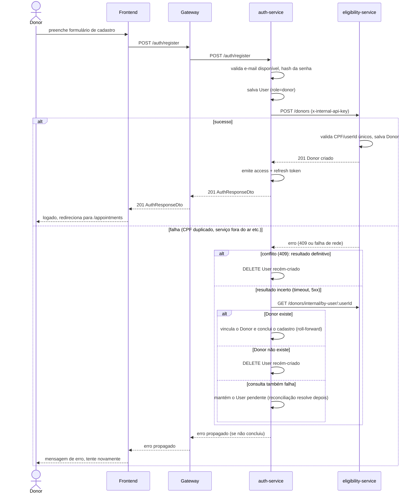
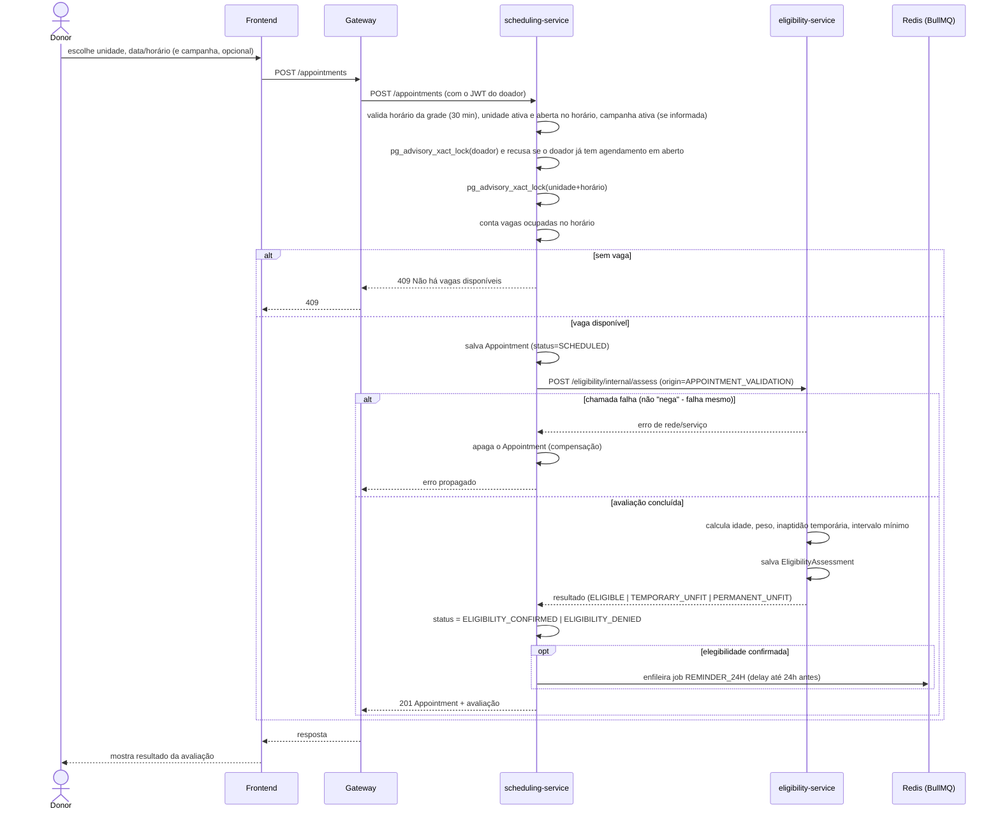
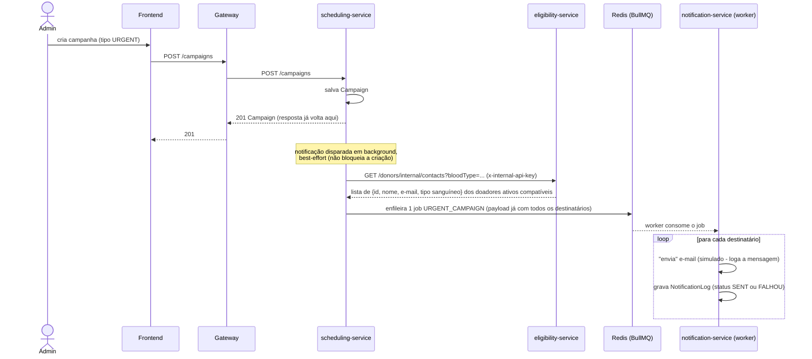

# 02. Diagramas de sequência

Diagramas dos fluxos mais importantes do sistema, todos passando pelo gateway (única porta de
entrada do frontend para o backend). Fontes: casos de uso em `backend/application/{auth,eligibility,scheduling}`
(`RegisterDonorUseCase`, `CreateAppointmentUseCase`, `CompleteAppointmentUseCase`, `AssessEligibilityUseCase`,
`CreateCampaignUseCase`), `NotificationQueuePublisher` (infrastructure) e `NotificationsProcessor` (presentation) (ver `01-modelagem-entidades.md` para as entidades envolvidas).

## 1. Cadastro de doador (saga com resultado sempre resolvível)

O `auth-service` cria o `User` primeiro (para já poder emitir os tokens) e pede o `Donor` ao
`eligibility-service`. Não há transação entre os dois, então o que fazer numa falha depende do que
se sabe do resultado: um **conflito** (CPF já cadastrado) é definitivo e o `User` é desfeito; já um
timeout ou resposta perdida é **incerto** (o `Donor` pode ter sido criado), e o auth pergunta ao
eligibility por `GET /donors/internal/by-user/:userId`. Se o `Donor` existe, o cadastro é concluído
(roll-forward); se não existe, o `User` é desfeito. Se nem a consulta responder, o `User` fica
pendente e o job de reconciliação (a cada minuto, depois de 2 minutos de carência) resolve do mesmo
jeito, inclusive após uma queda do processo. Assim nunca sobra `Donor` sem `User`, nem `User`
pendente para sempre.

Se o cliente repetir o cadastro enquanto o `User` ainda está pendente, o auth não responde "e-mail já
cadastrado": quando o e-mail pertence a um doador sem `Donor` vinculado **e a senha enviada confere**, o
cadastro é retomado (consulta se o `Donor` já existe e só o cria se não existir). Com senha diferente, ou
com `User` já vinculado, continua sendo conflito.



## 2. Criar agendamento (avaliação de elegibilidade síncrona + lock de vaga)

A avaliação de elegibilidade acontece **dentro** da requisição de criação do agendamento (não é
assíncrona) - por isso o status já nasce `ELIGIBILITY_CONFIRMED` ou `ELIGIBILITY_DENIED`, e
o frontend mostra o resultado imediatamente. Ver `01-modelagem-entidades.md`, seção 5.3, para o
detalhe do advisory lock usado para evitar overbooking.



## 3. Check-in e conclusão (admin) - atualização pós-doação

```mermaid
sequenceDiagram
    actor Admin
    participant FE as Frontend
    participant GW as Gateway
    participant Sched as scheduling-service
    participant Elig as eligibility-service
    participant Redis as Redis (BullMQ)

    Admin->>FE: clica "Check-in" (agendamento ELIGIBILITY_CONFIRMED ou CONFIRMED, no dia dele)
    FE->>GW: POST /appointments/:id/checkin
    GW->>Sched: POST /appointments/:id/checkin
    alt não é o dia do agendamento (Brasília)
        Sched-->>FE: 409 "O check-in só pode ser feito no dia do agendamento"
    end
    Sched->>Elig: POST /eligibility/internal/assess (APPOINTMENT_VALIDATION, donationDate = hoje)
    alt doador não está mais apto
        Sched-->>FE: 409 (a avaliação fica no histórico do doador; a equipe cancela o agendamento)
    end
    Sched->>Sched: status = CHECKIN_PERFORMED, checkinAt = agora
    Sched-->>FE: 200 (via GW)

    Admin->>FE: clica "Concluir" (agendamento CHECKIN_PERFORMED)
    FE->>GW: POST /appointments/:id/complete
    GW->>Sched: POST /appointments/:id/complete
    Sched->>Sched: status = COMPLETED, completedAt = agora
    Sched-->>FE: 200 (resposta já retorna, não espera o resto)
    par melhor esforço, assíncrono
        Sched->>Elig: POST /donors/:id/donations/complete (atualiza lastDonationAt)
        Sched->>Elig: POST /eligibility/internal/assess (origin=DONOR_QUERY, recalcula próxima data)
        Sched->>Redis: enfileira job INTERVAL_COMPLETED (avisa doador da próxima data elegível)
    end
```

## 3.1 Confirmação de presença (48h / 24h)

Ao criar o agendamento, o scheduling-service enfileira dois jobs atrasados: o pedido de confirmação
(48h antes, jobId `confirmation-<id>`) e o lembrete (24h antes, jobId `reminder-<id>`), ambos com o link
com token. Se faltar menos de 24h, só o lembrete é enviado (sem e-mail duplicado).

```mermaid
sequenceDiagram
    actor Donor
    participant FE as Frontend
    participant Sched as scheduling-service
    participant Redis as Redis (BullMQ)

    Redis-->>Donor: e-mail 48h antes (link /confirm-attendance?token=...)
    Donor->>FE: abre o link e clica "Confirmar presença"
    FE->>Sched: POST /appointments/confirm-attendance {token}
    Sched->>Sched: verifica HMAC e validade; ELIGIBILITY_CONFIRMED -> CONFIRMED, confirmedAt = agora
    Sched->>Redis: remove job de pedido; zera o link do lembrete de 24h
    Sched-->>FE: 200 {id, dateTime, status, confirmedAt}
```

A confirmação só ocorre ao clicar no botão (scanners de e-mail que abrem o link não confirmam).
Quem não confirma continua com a vaga e aparece destacado ("Aguardando confirmação") para o admin.
O cancelamento do agendamento remove os dois jobs pendentes.

## 4. Campanha urgente - notificação assíncrona em massa

Diferente do lembrete individual (item 2), a notificação de campanha é para **muitos** doadores
de uma vez - por isso é sempre assíncrona e resolvida fora do caminho crítico de criar a
campanha (o admin não espera o disparo de e-mails para receber a resposta).



## 5. Login e renovação de token (refresh)

```mermaid
sequenceDiagram
    actor User
    participant FE as Frontend
    participant GW as Gateway
    participant Auth as auth-service

    User->>FE: e-mail + senha
    FE->>GW: POST /auth/login
    GW->>Auth: POST /auth/login
    Auth->>Auth: valida senha (bcrypt), gera access token (15min) + refresh token (7d)
    Auth->>Auth: salva hash SHA-256 do refresh token
    Auth-->>FE: accessToken + dados do usuário no corpo; refresh token em cookie httpOnly (Set-Cookie, via GW)
    FE->>FE: guarda o access token só em memória (localStorage guarda apenas o perfil)

    Note over FE: em qualquer requisição autenticada depois...
    FE->>GW: requisição com Authorization: Bearer <accessToken>
    alt access token válido
        GW-->>FE: 200
    else access token expirado (401)
        FE->>GW: POST /auth/refresh (o navegador envia o cookie httpOnly)
        GW->>Auth: POST /auth/refresh
        Auth->>Auth: valida hash, não revogado, não expirado
        Auth->>Auth: rotaciona: revoga o antigo, emite um novo par
        Auth-->>FE: novo accessToken no corpo + novo cookie (via GW)
        FE->>FE: atualiza a store, refaz a requisição original
    end
```

O interceptor do axios no frontend (`shared/api/http.ts`) usa uma única promise compartilhada
para deduplicar renovações simultâneas: se várias requisições caírem em 401 ao mesmo tempo, só
uma chamada a `/auth/refresh` é feita, e todas aguardam o mesmo resultado. Ao recarregar a página
o access token (só em memória) não existe mais: o primeiro 401 dispara a renovação silenciosa pelo cookie.
